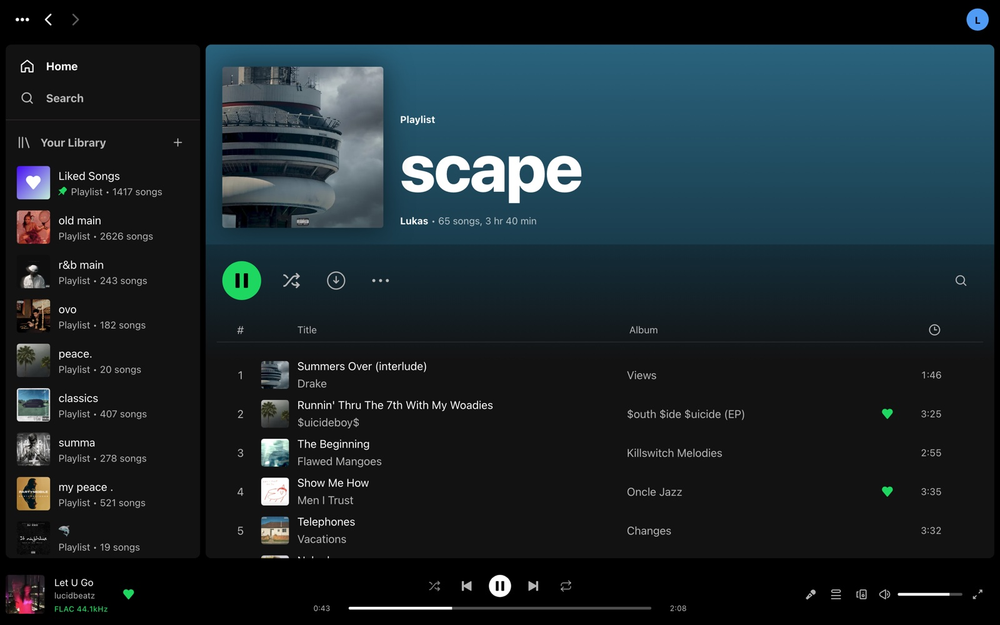
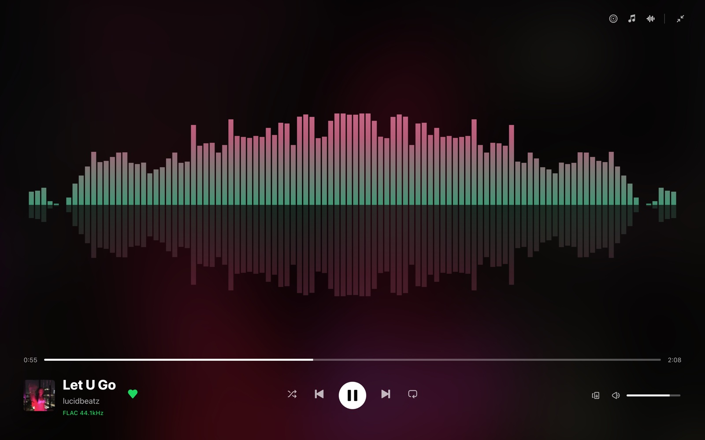
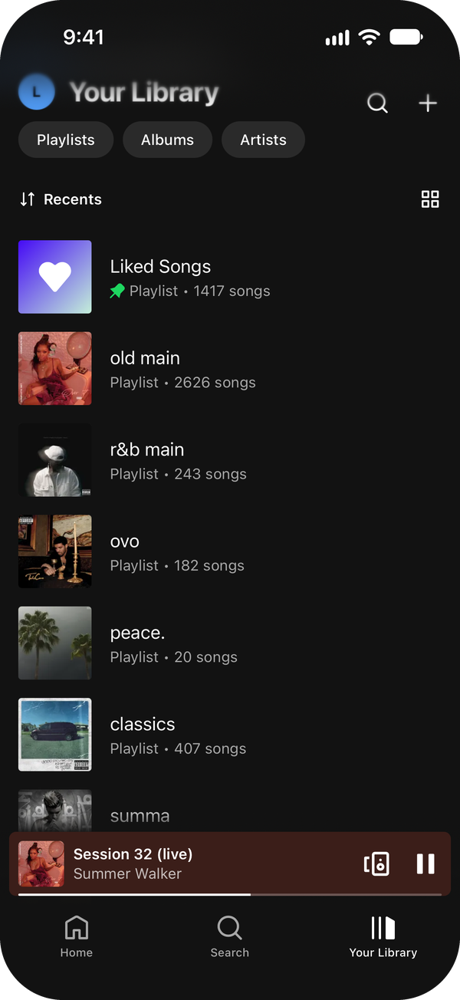
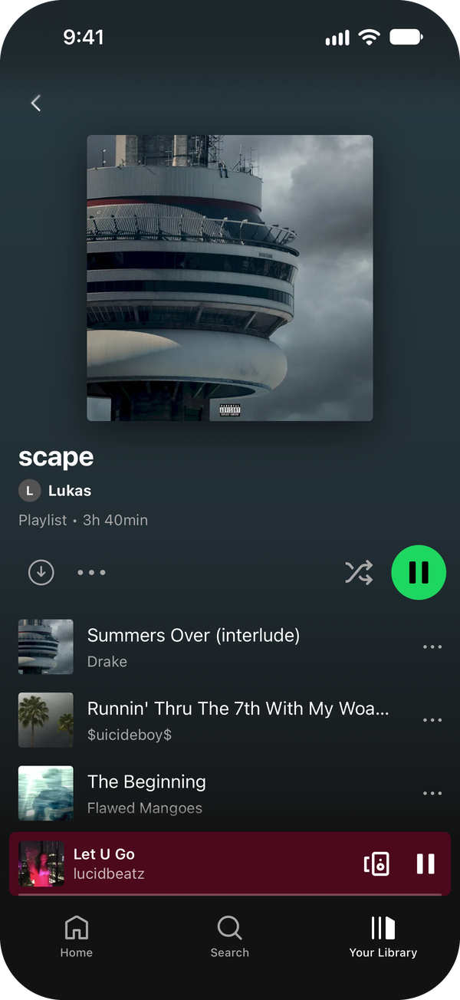

# Slopify

<p align="center">
  <a href="https://slopify.lukasbaxter.ca"></a>
  <br>
  <sub>No sign-up. 30-second clips, settings are look-only.</sub>
</p>

<p align="center">
  <a href="https://github.com/lukasbaxter/slopify/releases/latest"></a>
  <a href="https://github.com/lukasbaxter/slopify/pkgs/container/slopify"></a>
  <a href="docs/home-assistant.md"></a>
  <a href="LICENSE"></a>
  <a href="https://github.com/lukasbaxter/slopify/actions/workflows/ci.yml"></a>
</p>

**Your own Spotify, for your own music.** Point one Docker container at your
music folder and everyone in your household gets Spotify-style apps on the web,
Android, iPhone, Mac and Windows: their own likes, playlists and Home page,
synced lyrics, and one session that follows them from phone to desk to the
living-room speakers.

<sub>As seen in [Self-Host Weekly, 30 October 2026](https://selfh.st/weekly/2026-10-30/).</sub>

<p align="center">
  
  
  
</p>
<p align="center">
  
  
  
  
</p>

## What it does

- **Feels like Spotify.** Home with daily mixes and your top songs, Liked
  Songs, playlists, search, artist pages with banners and Popular (from
  ListenBrainz), queue, history.
- **Sounds right.** Plays your original files (FLAC, ALAC, MP3...) or a
  quality you pick per device, adaptive on a weak signal. Volume
  normalization (-14 LUFS, albums keep their balance), crossfade and gapless
  on computers and Android, a sleep timer on everything.
- **Lyrics.** Your `.lrc` files, else LrcLib; optional syncing on a GPU.
- **One session per person.** Start on the phone, carry on at the desk,
  control one device from another.
- **Speakers.** Chromecast and BluOS speakers (and groups) are driven by the
  server, so any phone or browser can play to them. DIY speakers work too:
  anything answering the small `slopify-speaker/1` HTTP API on port 7780
  (documented at `BridgeTransport` in `server/src/speakers/transports.ts`).
- **Household accounts.** Invite links, admin roles, sign-ins revocable per
  device.
- **Home Assistant.** Every account and speaker becomes a media player.
- **Works on a bad connection.** The apps keep what you have opened and play
  downloaded music offline.
- **Optional extras.** Lidarr and slskd for filling the library, ListenBrainz
  scrobbling and weekly playlists, playlists generated by Claude, your
  Spotify listening history imported.

Free software ([AGPL v3](LICENSE)). No telemetry, no accounts with anyone:
[what leaves your server](PRIVACY.md) lists every outside service and how to
turn it off. Not affiliated with Spotify.

### How it compares

Navidrome and Jellyfin are great servers that work with many third-party
apps. Slopify makes the other trade: it ships its own apps, so every device
looks and behaves the same, and the server owns your session, so phones,
computers and speakers stay in step. If you want to pick your own client
app, they are the better fit. Slopify reads your music folder read-only, so it
can sit beside either.

### How it is built

Slopify is written with a lot of help from AI (Claude), and is used every day
by a real household on its own library. Server tests and Playwright browser
tests run in CI on every change. It is young (0.1.x): expect frequent
releases, and please [open an issue](https://github.com/lukasbaxter/slopify/issues)
when something breaks. The apps also have Settings › Help › Logs and problem
reports, which send a report to your own server.

## Quick start

You need Docker with Compose, and a folder of music (any layout; tags are
read from the files). The image runs on amd64 and arm64 (Raspberry Pi 4/5,
ARM NAS boxes).

1. Save this as `compose.yml` and change the music path:

   ```yaml
   services:
     slopify:
       image: ghcr.io/lukasbaxter/slopify:latest
       container_name: slopify
       restart: unless-stopped
       network_mode: host        # lets it find and play to Chromecast / BluOS speakers
       volumes:
         - /path/to/music:/music:ro
         - ./data:/data
       environment:
         PORT: "8080"
         TZ: Europe/London   # your time zone, for scheduled tasks
   ```

2. `docker compose up -d`
3. Open `http://<server>:8080`, sign in as `admin` / `admin` and choose a new
   password. The library scans on its own; a few thousand songs take a
   minute or two.
4. Add your household in Settings › Accounts (or send them an invite), and
   get the apps from the [releases page](https://github.com/lukasbaxter/slopify/releases).

`docker compose logs slopify` says what it found: your music folder, the
speakers' address, anything it could not do. Most first-run problems are
spelled out there.

### Good to know

- **Your music folder is read-only to Slopify** unless you ask otherwise.
  `SAVE_TO_LIBRARY=1` writes found lyrics and artwork next to your files
  (drop the `:ro` then).
- **It runs as uid 1000.** It sets up `./data` itself; the music needs to be
  readable by that user. `PUID` / `PGID` pick a different user.
- **Speakers need host networking.** With Docker's default network
  (`ports: ["8080:8080"]` instead of `network_mode: host`) everything else
  works, but no speakers are found and Home Assistant needs the address typed
  in. Speakers fetch audio from the server's LAN address, worked out on its
  own; set `PUBLIC_URL` if the log shows the wrong one.
- **Outside your home**, put it behind HTTPS: [reverse proxy setup](docs/reverse-proxy.md).

## More

- [Configuration](docs/configuration.md): every setting.
- [HTTPS and a reverse proxy](docs/reverse-proxy.md): Caddy, nginx, Traefik.
- [Backups and upgrades](docs/backup-and-upgrade.md): what to keep, pinning versions, moving machines.
- [Downloads with Lidarr and slskd](docs/downloads.md): discographies, requests, the Tasks list.
- [Sync lyrics on a GPU](docs/lyric-sync.md): the GPU image.
- [Home Assistant](docs/home-assistant.md): the integration, installed with HACS.
- [iPhone](docs/iphone.md): the Home Screen web app, or the app through SideStore.

Home Assistant, in two clicks:

[](https://my.home-assistant.io/redirect/hacs_repository/?owner=lukasbaxter&repository=slopify&category=integration)
[](https://my.home-assistant.io/redirect/config_flow_start/?domain=slopify)

## Develop

```
npm install
npm run fixtures        # generates a 30-track fake library in fixtures/music (needs ffmpeg)
MUSIC_DIR=$PWD/fixtures/music CONFIG_DIR=$PWD/data npm run dev   # server on :8080
# (absolute paths: npm runs the dev script with server/ as its cwd)
npm run dev -w web      # web on :5180, proxies /api to the server
npm test                # unit (vitest)
npm run e2e             # Playwright against the fixture library
```

Tests never touch a real library or account: they run against the fixture
folder and a data dir under /tmp.

## License

Slopify is free software: you can redistribute it and/or modify it under the
terms of the [GNU Affero General Public License v3](LICENSE) or (at your option)
any later version. If you run a modified Slopify that other people use over a
network, offer them its source (set `SOURCE_URL`).

The Home Assistant integration (`custom_components/slopify`) is licensed under
the [Apache License 2.0](custom_components/slopify/LICENSE), like Home Assistant.

Third-party software and its licenses: [NOTICE](NOTICE) and
[THIRD_PARTY_LICENSES.md](THIRD_PARTY_LICENSES.md).

## Contributing, security, conduct

- [CONTRIBUTING.md](CONTRIBUTING.md): development setup, tests, pull requests.
- [SECURITY.md](SECURITY.md): report vulnerabilities privately.
- [CODE_OF_CONDUCT.md](CODE_OF_CONDUCT.md): Contributor Covenant 2.1.

Slopify is not affiliated with, endorsed by or connected to Spotify AB.
"Spotify" is a trademark of Spotify AB.
