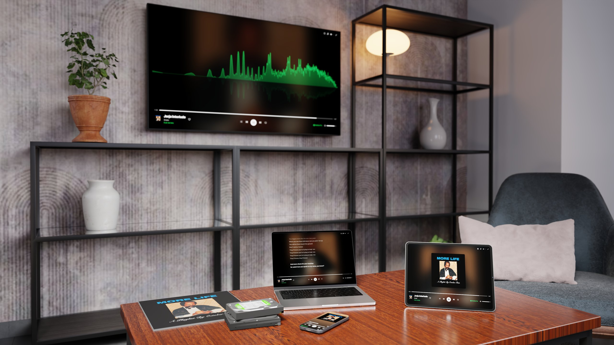

# Slopify



<p align="center">
  <a href="https://github.com/lukasbaxter/slopify/releases/latest"></a>
  <a href="https://github.com/lukasbaxter/slopify/releases"></a>
  <a href="LICENSE"></a>
  <a href="https://github.com/lukasbaxter/slopify/actions/workflows/ci.yml"></a>
  <a href="https://github.com/lukasbaxter/slopify/actions/workflows/docker.yml"></a>
  <a href="https://github.com/lukasbaxter/slopify/actions/workflows/home-assistant.yml"></a>
  <br>
  <a href="docs/home-assistant.md"></a>
  <a href="https://hacs.xyz"></a>
  <a href="https://github.com/lukasbaxter/slopify/pkgs/container/slopify"></a>
  
  <br>
  
  
  <a href="https://github.com/lukasbaxter/slopify/issues"></a>
  
  <a href="https://github.com/lukasbaxter/slopify/stargazers"></a>
</p>

Self-hosted music: one container and your music folder give your household
Spotify-style apps (web, Android, iPhone, Mac, Windows) with a shared session across
them, Chromecast and BluOS speakers driven by the server, and a Home Assistant
integration.

Free software under the [GNU AGPL v3](LICENSE). No telemetry, no accounts with
anyone: [what leaves your server](PRIVACY.md) lists every outside service and
how to turn it off. Not affiliated with Spotify.

## Quick start

You need Docker with Compose, and a folder of music (any layout; tags are
read from the files). The image runs on amd64 and arm64 (Raspberry Pi 4/5,
ARM NAS boxes).

1. Save this as `compose.yml` and change the music path:

   ```yaml
   services:
     slopify:
       image: ghcr.io/lukasbaxter/slopify:latest
       container_name: slopify
       restart: unless-stopped
       network_mode: host        # lets it find and play to Chromecast / BluOS speakers
       volumes:
         - /path/to/music:/music:ro
         - ./data:/data
       environment:
         PORT: "8080"
         TZ: Europe/London   # your time zone, for scheduled tasks
   ```

2. `docker compose up -d`
3. Open `http://<server>:8080`, sign in as `admin` / `admin` and choose a new
   password. The library scans on its own; a few thousand songs take a
   minute or two.
4. Add your household in Settings › Accounts (or send them an invite), and
   get the apps from the [releases page](https://github.com/lukasbaxter/slopify/releases).

`docker compose logs slopify` says what it found: your music folder, the
speakers' address, anything it could not do. Most first-run problems are
spelled out there.

### Good to know

- **Your music folder is read-only to Slopify** unless you ask otherwise.
  `SAVE_TO_LIBRARY=1` writes found lyrics and artwork next to your files
  (drop the `:ro` then).
- **It runs as uid 1000.** It sets up `./data` itself; the music needs to be
  readable by that user. `PUID` / `PGID` pick a different user.
- **Speakers need host networking.** With Docker's default network
  (`ports: ["8080:8080"]` instead of `network_mode: host`) everything else
  works, but no speakers are found and Home Assistant needs the address typed
  in. Speakers fetch audio from the server's LAN address, worked out on its
  own; set `PUBLIC_URL` if the log shows the wrong one.
- **Outside your home**, put it behind HTTPS: [reverse proxy setup](docs/reverse-proxy.md).

## More

- [Configuration](docs/configuration.md): every setting.
- [HTTPS and a reverse proxy](docs/reverse-proxy.md): Caddy, nginx, Traefik.
- [Backups and upgrades](docs/backup-and-upgrade.md): what to keep, pinning versions, moving machines.
- [Downloads with Lidarr and slskd](docs/downloads.md): discographies, requests, the Tasks list.
- [Sync lyrics on a GPU](docs/lyric-sync.md): the GPU image.
- [Home Assistant](docs/home-assistant.md): the integration, installed with HACS.
- [iPhone](docs/iphone.md): the Home Screen web app, or the app through SideStore.

Home Assistant, in two clicks:

[](https://my.home-assistant.io/redirect/hacs_repository/?owner=lukasbaxter&repository=slopify&category=integration)
[](https://my.home-assistant.io/redirect/config_flow_start/?domain=slopify)

## What it does

- Browse and search your library; play the original files or a quality you
  pick per device (adaptive on a weak signal); lyrics (your `.lrc` files, else LrcLib), artist pictures and
  banners, album art.
- Spotify's playback basics: volume normalization (every song measured once,
  played at -14 LUFS; albums keep their own balance), crossfade and gapless
  playback on computers and Android, and a sleep timer that works on any device.
- Likes, playlists, history and a Home page built from your own listening;
  Popular per artist from ListenBrainz.
- One session per person across every device: start on the phone, carry on
  at the desk, control one from another.
- Chromecast and BluOS speakers driven by the server, so any phone or browser
  can pick them, and speaker groups.
- DIY speakers: anything answering the small `slopify-speaker/1` HTTP API on
  port 7780 is found and played to like the others (the protocol is
  documented at `BridgeTransport` in `server/src/speakers/transports.ts`).
- Accounts with invites and admin roles; sign-ins revocable per device.
- Optional: Lidarr and slskd for filling the library, ListenBrainz
  scrobbling and weekly playlists, generated playlists (Claude), synced
  lyrics on a GPU.
- Imports your Spotify listening history.

## Develop

```
npm install
npm run fixtures        # generates a 30-track fake library in fixtures/music (needs ffmpeg)
MUSIC_DIR=$PWD/fixtures/music CONFIG_DIR=$PWD/data npm run dev   # server on :8080
# (absolute paths: npm runs the dev script with server/ as its cwd)
npm run dev -w web      # web on :5180, proxies /api to the server
npm test                # unit (vitest)
npm run e2e             # Playwright against the fixture library
```

Tests never touch a real library or account: they run against the fixture
folder and a data dir under /tmp.

## License

Slopify is free software: you can redistribute it and/or modify it under the
terms of the [GNU Affero General Public License v3](LICENSE) or (at your option)
any later version. If you run a modified Slopify that other people use over a
network, offer them its source (set `SOURCE_URL`).

The Home Assistant integration (`custom_components/slopify`) is licensed under
the [Apache License 2.0](custom_components/slopify/LICENSE), like Home Assistant.

Third-party software and its licenses: [NOTICE](NOTICE) and
[THIRD_PARTY_LICENSES.md](THIRD_PARTY_LICENSES.md).

## Contributing, security, conduct

- [CONTRIBUTING.md](CONTRIBUTING.md): development setup, tests, pull requests.
- [SECURITY.md](SECURITY.md): report vulnerabilities privately.
- [CODE_OF_CONDUCT.md](CODE_OF_CONDUCT.md): Contributor Covenant 2.1.

Slopify is not affiliated with, endorsed by or connected to Spotify AB.
"Spotify" is a trademark of Spotify AB.

Cover image: rendered in Blender on free assets, credits in [docs/images/CREDITS.md](docs/images/CREDITS.md).
